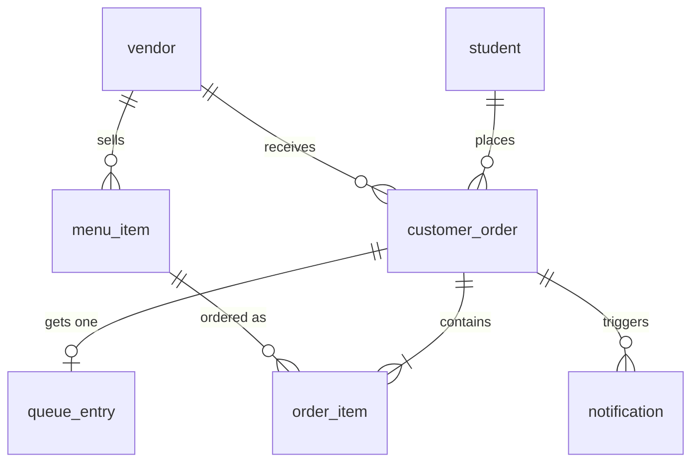

# Database documentation

PostgreSQL 16 or newer (developed on 18). Database name comes from `DB_NAME` in `.env`
(default `canteen_db`). Single schema: `public`. Owner: the login in `DB_USER`
(default `canteen_admin`).

## How it is created

`database/setup.ps1` (Windows) or `database/setup.sh` (Linux/macOS) runs, in order:

| Order | File | What it does |
|---|---|---|
| 1 | `database/init/001_create_role_and_database.sql` | Creates the login and database if missing |
| 2 | `database/migrations/001_create_tables.sql` | Creates the 7 tables |
| 3 | `database/migrations/002_auth_columns.sql` | Adds login columns (see "Changes from the approved design") |
| 4 | `database/seed/001_sample_data.sql` | Loads sample accounts, stalls, menus and today's orders |

Every file can be run repeatedly without errors or duplicate rows.
`database/reset.sql` empties all tables and restarts the ID counters.

## ERD

## Tables

| Table | Primary key | Foreign keys | Other constraints |
|---|---|---|---|
| `student` | `student_id` | none | `email` UNIQUE, NOT NULL; `role` CHECK in (`STUDENT`,`ADMIN`), default `STUDENT` |
| `vendor` | `vendor_id` | none | `email` UNIQUE (nullable); `password_hash` nullable; `is_active` default TRUE |
| `menu_item` | `item_id` | `vendor_id` to `vendor` | `price` CHECK >= 0; `is_available` default TRUE |
| `customer_order` | `order_id` | `student_id` to `student`, `vendor_id` to `vendor` | `status` CHECK in (`pending`,`preparing`,`ready`,`completed`,`cancelled`) |
| `order_item` | `order_item_id` | `order_id` to `customer_order`, `item_id` to `menu_item` | `quantity` CHECK > 0; `price_at_order` keeps the price at the time of ordering |
| `queue_entry` | `queue_id` | `order_id` to `customer_order` (UNIQUE, one slot per order) | UNIQUE (`queue_number`, `queue_date`); `status` CHECK in (`waiting`,`called`,`served`) |
| `notification` | `notification_id` | `order_id` to `customer_order` | `is_read` default FALSE |

`customer_order` is named that way because `order` is a reserved SQL word.
The indexes are the ones PostgreSQL creates for primary keys and UNIQUE constraints.
No other indexes have been added.

## Business rules enforced in the database

- Queue numbers are unique per day (UNIQUE on `queue_number`, `queue_date`). The API also
  takes a PostgreSQL advisory lock when assigning one, so simultaneous orders take turns.
- An order has at most one queue entry.
- Order status and queue status can only hold the listed values.
- Prices cannot be negative and quantities must be positive.

## Changes from the approved Activity 2 design

| Change | Reason |
|---|---|
| `vendor.email` (unique) and `vendor.password_hash` added | Vendors log in to manage their menu and orders |
| `student.role` added (`STUDENT` or `ADMIN`) | Administrators log in too. An admin is a student row with role `ADMIN` instead of a separate table |

## Hibernate validation

`spring.jpa.hibernate.ddl-auto=validate`: the API never creates or alters tables. If a column
is missing, startup fails with `Schema-validation: missing column`. Run the setup script again.
